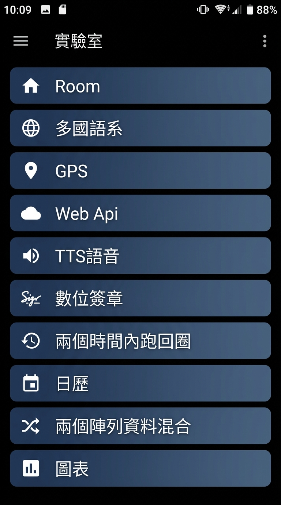
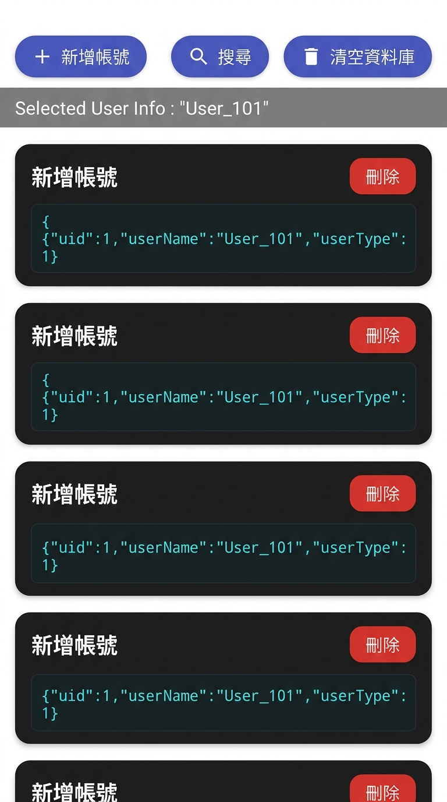
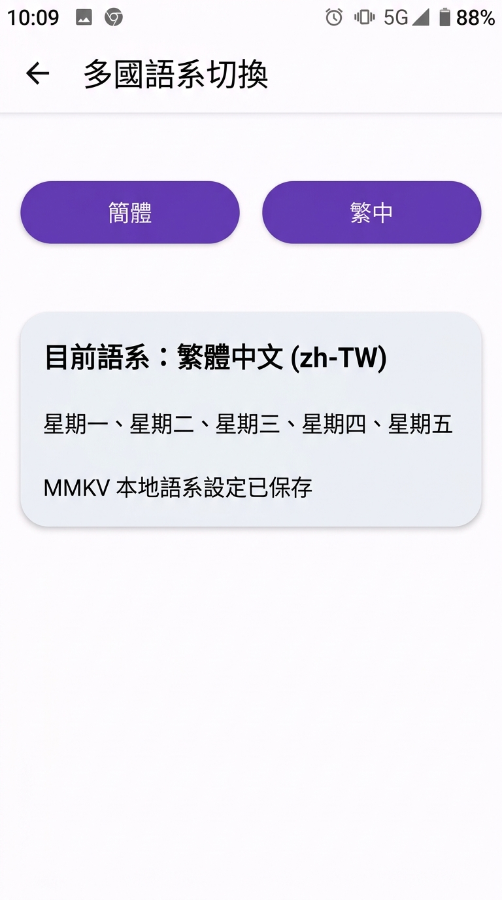
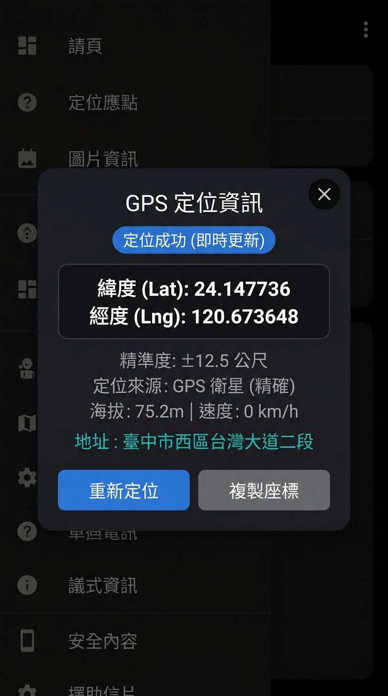
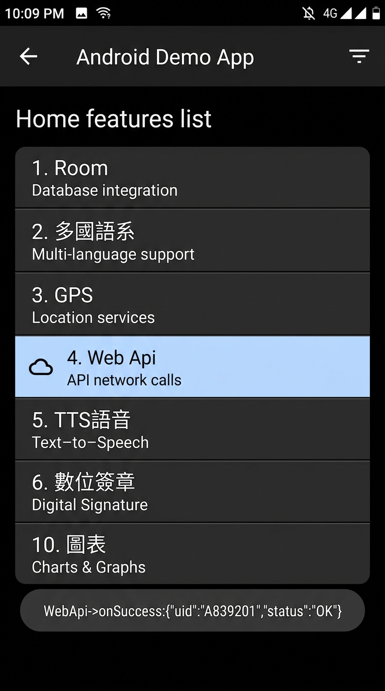
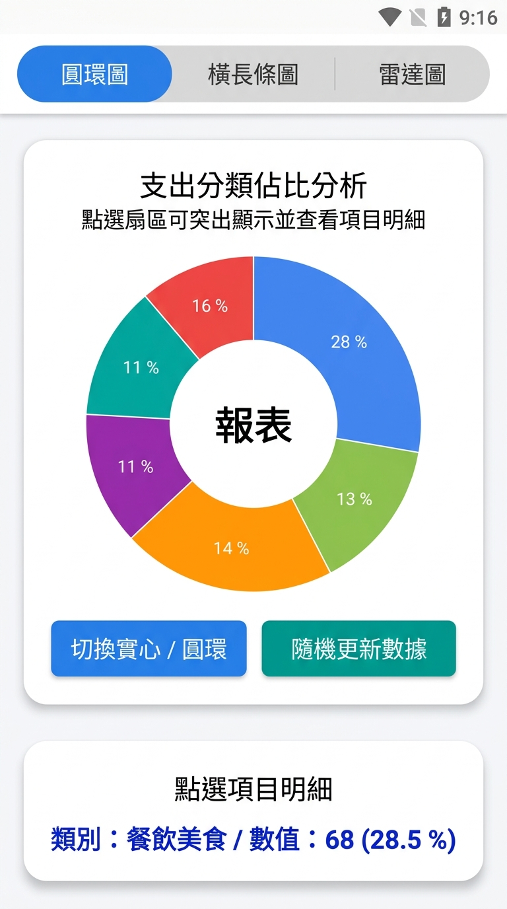

# Lin New Project Kotlin AI — 模組化 Android 開發與元件展示 App

> 以既有模組化 Android 專案為基礎，整合過往開發常見的 30 項實用功能模組，並透過 **AI 輔助開發（AI-Assisted Engineering）** 持續進行**功能優化、BUG 修復與新功能擴充**。

---

## 1. App 介紹

**Lin New Project Kotlin AI** (`com.example.lin_new_project_kotlin_ai`) 是一個以「高複用、模組化」為核心設計理念的 Android 應用程式範本與功能測試平台。專案採用 **Kotlin 與 Java 混合開發**，整合了 App 最常使用的底層架構與系統工具，協助開發者快速驗證功能、重用成熟元件，並作為技術展示與教學基底。

### 為什麼結合 AI 輔助開發？
在從舊專案重構與現代化演進的過程中，專案全面導入 AI 輔助流程，具體涵蓋三大面向：
- **功能優化**：針對既有模組進行架構與體驗升級（例如強化 `GPSPositioningMethod` 多來源定位與非同步地址解析、導入 Room `AutoMigration` v1 → v5 自動遷移機制、統一 `PopupWindowManager` 彈窗交互流程、將 `MPAndroidChartFragment` 升級為 Segmented Tab 現代化介面）。
- **BUG 處理**：精準定位並修復歷史遺留問題（例如修正圖表頁面預設空白與橫向長條圖 5000px 硬編碼裁切問題、消除大量高風險非空斷言 `!!` 造成的 Crash 隱患、補強 RxJava `CompositeDisposable` 生命週期釋放以避免記憶體洩漏）。
- **功能開發**：加速新模組與輔助工具的撰寫與整合（如自訂雷達圖繪製、URL 自動擷取、記事本管理、單元測試覆蓋等），讓開發者專注於業務邏輯設計。

### 技術棧一覽
| 類別 | 使用技術 / 套件 |
|---|---|
| **程式語言** | Kotlin 2.2.10 + Java 17 |
| **畫面與導航** | ViewBinding、DataBinding、Jetpack Navigation (SafeArgs) |
| **本地儲存** | Room 2.6.1 (KSP + AutoMigration)、Tencent MMKV 1.2.14 |
| **網路通訊** | Retrofit 2.9.0、OkHttp 3.12.2、Gson (自訂容錯 Adapter) |
| **非同步處理** | RxJava 2 / RxJava 3、RxAndroid |
| **圖表與繪圖** | MPAndroidChart v3.1.0、自訂 Canvas (`RadarView` / `Radar2View`)、OpenGL ES |
| **硬體與系統功能** | LocationManager + Geocoder、ZXing、NFC、TTS、MediaRecorder |

### 首頁總覽
App 首頁透過 `RecyclerView` 集中管理 30 項功能入口，點擊即可跳轉對應模組或觸發即時互動彈窗：

<p align="center">
  
</p>

---

## 2. 主要功能介紹（五大核心模組）

以下精選本專案最核心的 **5 項基礎與業務常用模組**，說明其技術架構、核心優點與實際應用場景：

---

### 2.1 Room 本地資料庫 (`RoomFragment` / `DBDatabase` / `DatabaseManager`)

<p align="center">
  
</p>

- **技術實作**：
  - 建立 `UserProfileEntity`、`FavoritesEntity`、`HistoryEntity` 三張資料表與關聯查詢（`UserProfileAndFavorites`）。
  - 透過 `@TypeConverters(Converters::class)` 整合 `Gson` 將複雜物件直接序列化存入 SQLite。
  - 使用 `DatabaseManager` 單例搭配 RxJava2 (`Completable` / `Flowable`) 執行非同步 CRUD 操作，並實作 **Room AutoMigration (v1 → v5)**（包含新增欄位與 `@RenameColumn` Spec）。
- **功能優點**：
  - **編譯期 SQL 檢查**：減少執行期查詢語法錯誤。
  - **版本升級零痛點**：支援 `AutoMigration` 自動遷移與 Schema 匯出（`app/schemas/`），確保版本更新後保留使用者舊資料。
  - **安全防呆與效能兼顧**：所有寫入與查詢皆在 `Schedulers.io()` 背景執行，刪除與清空資料庫操作前均跳出二次確認彈窗（`DeleteConfirmPopupWindow`），並於 `onDestroyView()` 清除訂閱防止記憶體洩漏。
- **使用場景**：
  - 離線會員帳號管理與使用者偏好資料暫存。
  - 瀏覽歷史紀錄（History）與個人收藏清單（Favorites）本地化儲存。
  - 需頻繁迭代資料欄位且不能遺失本地資料的商用 App。

---

### 2.2 多國語系切換 (`LanguageFragment` / `LanguageUtils` / `LanguageEnum`)

<p align="center">
  
</p>

- **技術實作**：
  - 透過 `LanguageEnum` 集中管理支援語系（繁體中文 `TW`、簡體中文 `CN`、English `US`、日本語 `JP`、Español `ES`），對應 `values/`、`values-zh-rTW/`、`values-zh-rCN/` 資源檔。
  - 結合 `MmkvUtils`（Tencent MMKV）持久化儲存使用者選擇的語系代碼。
  - 於 `MainActivity.attachBaseContext()` 覆寫 `Configuration` 與 `LocaleList`，切換語系時呼叫 `ActivityCompat.recreate()` 即時重繪畫面。
- **功能優點**：
  - **即時生效免重啟 App**：利用 `ActivityCompat.recreate()` 直接刷新當前頁面資源，使用者體驗流暢。
  - **高效能持久化**：MMKV 讀寫速度遠高於傳統 `SharedPreferences`，App 冷啟動時即可秒速載入對應語系。
  - **高擴充性**：語系定義與 UI 邏輯解耦，新增語言只需擴充 Enum 與對應 `strings.xml` 即可。
- **使用場景**：
  - 面向多國家或跨語系用戶的跨境電商、旅遊導覽、國際化 SaaS 工具。
  - 需在 App 內提供「獨立於系統語言設定」的語言切換選項之應用。

---

### 2.3 GPS 即時定位與地址反查 (`GPSPositioningMethod` / `GpsInfoPopupWindow`)

<p align="center">
  
</p>

- **技術實作**：
  - `GPSPositioningMethod` 整合 `LocationManager` 三大定位來源（`GPS_PROVIDER`、`NETWORK_PROVIDER`、`PASSIVE_PROVIDER`）。
  - 先快速取得快取位置（`getLastKnownLocation()`），再註冊 `LocationListener` 即時監聽更新，並以 `getBetterLocation()` 綜合評估時間差（2 分鐘閾值）與精準度（Accuracy）篩選最佳座標。
  - 透過單一背景執行緒（`ExecutorService`）執行 `Geocoder` 反向地理編碼取得街道中文地址，最後透過 `GpsInfoPopupWindow` 呈現經緯度、精準度、來源、海拔、速度與地址，並支援「重新定位」與「一鍵複製座標」。
- **功能優點**：
  - **兼顧速度與精準度**：快取座標秒開顯示 + 即時監聽自動修正為最新精確點位，徹底解決舊版僅取 `getLastKnownLocation` 容易為 `null` 的問題。
  - **省電與安全機制**：彈窗 `dismiss()` 時自動呼叫 `stopGPS()` 釋放硬體監聽；執行前自動檢查權限與系統定位服務是否開啟，未開啟則引導至系統設定頁。
  - **非同步防卡頓**：`Geocoder` 網路/系統查詢於背景執行緒運行，避免阻塞 UI 主執行緒。
- **使用場景**：
  - 外勤人員考勤打卡、現場巡檢回報與環境清潔勤務追蹤。
  - 物流配送即時座標記錄、緊急定位求助或附近服務據點查詢。

---

### 2.4 Web API 網路服務 (`WebApi` / `IWebApiPath` / `DefaultAdapter`)

<p align="center">
  
</p>

- **技術實作**：
  - 採用 **Retrofit 2 + OkHttp 3 + RxJava 2** 封裝通用 API 請求框架（`WebApi.request()`）。
  - 支援多格式轉換鏈：`ScalarsConverterFactory`（純文字/XML 包裝回應）優先於 `GsonConverterFactory`（實體 JSON 物件）。
  - 自訂四大 `Gson` 容錯 TypeAdapter（`IntegerDefaultAdapter`、`DoubleDefaultAdapter`、`LongDefaultAdapter`、`StringNullAdapter`），自動將後端回傳的 `""` 或 `null` 安全轉為預設值。
  - 透過 `OkHttpClient` 設定連線/讀寫超時（6s / 30s）、失敗重試與 `Interceptor` Header 擴充機制，並在請求前先以 `CommonUtils.isConnected()` 檢查網路狀態。
- **功能優點**：
  - **極強的資料容錯力**：解決實際商用後端常出現數字欄位回傳空字串或 `null` 導致 `JsonSyntaxException` 閃退的痛點。
  - **標準化生命週期與錯誤處理**：統一透過 `IResponseListener<T>` 回傳 `onSuccess` / `onFail`，請求完成自動釋放 `CompositeDisposable`。
  - **離線快速攔截**：無網路連線時不浪費資源發起 Socket 連線，直接回調失敗提示。
- **使用場景**：
  - 企業級 App 串接既有 RESTful API 或傳統 ASMX Web Service（如範例中串接裝置識別碼取得 `getUid` 服務）。
  - 資料欄位格式不完全嚴謹、需高度防禦性解析的外部開放資料平台或跨系統串接。

---

### 2.5 互動式數據圖表 (`MPAndroidChartFragment` / `PieChartMethod` / `RadarView`)

<p align="center">
  
</p>

- **技術實作**：
  - 頂部採用三段式分頁切換（`圓環圖`、`橫長條圖`、`雷達圖`），進入畫面即預設載入「支出分類佔比分析」圓環圖。
  - **圓環 / 餅圖 (`PieChartMethod`)**：支援切換「實心餅圖 / 甜甜圈圓環」、點擊扇區高亮並於下方卡片即時顯示類別數值與百分比、一鍵隨機刷新數據。
  - **橫向堆疊長條圖 (`HorizontalBarChart`)**：展示 6 項業務指標達成率（「已達成」翠綠 vs「未達成」灰藍）與動畫進場效果。
  - **五維 / 六維雷達圖 (`RadarView` / `Radar2View`)**：自訂 `View` 透過 `Canvas` 繪製多邊形網格、頂點、半透明覆蓋區域與隨機能力值互動更新。
- **功能優點**：
  - **高互動性與即時回饋**：支援手勢點擊扇區查看明細與動態切換圖表樣式，提升數據閱讀體驗。
  - **AI 優化修復實證**：修正原版進入頁面空白與橫向長條圖寬度硬編碼 `5000px` 導致被裁切無法捲動的嚴重問題。
  - **標準庫與自繪並存**：結合 `MPAndroidChart` 成熟統計圖表與自訂 `Canvas` 雷達圖，展現靈活的 UI 客製化能力。
- **使用場景**：
  - 個人記帳、消費類別佔比統計與財務管理儀表板。
  - 企業 KPI 業績達成率追蹤報表。
  - 遊戲角色能力值、員工技能評估或體適能檢測之多維度雷達分析。

---

## 3. 完整 30 項功能模組總覽

除了上述 5 大核心模組，本專案亦內建以下常見 Android 開發模組，皆可從首頁直接測試：

| 編號 | 模組名稱 | 編號 | 模組名稱 | 編號 | 模組名稱 |
|---|---|---|---|---|---|
| 1 | **Room 本地資料庫** | 11 | ViewFlipper / ViewPager | 21 | 震動與系統鈴聲控制 |
| 2 | **多國語系切換** | 12 | 音訊錄音與播放 (`MediaRecorder`) | 22 | 螢幕恆亮 / 休眠控制 |
| 3 | **GPS 即時定位** | 13 | NFC 近場感應讀取 | 23 | 系統狀態列與標題列隱藏 |
| 4 | **Web API 網路串接** | 14 | RecyclerView 拖曳排序 | 24 | GIF 動畫播放 |
| 5 | TTS 文字轉語音 | 15 | 網路連線狀態偵測 | 25 | WebView 網頁與本地 HTML 載入 |
| 6 | 數位手寫簽章 | 16 | 自訂 `AlertDialog` | 26 | 懸浮視窗 (`WindowManager`) |
| 7 | 時間區間迴圈計算 | 17 | 記事本 (`NotebookFragment`) | 27 | 多時區時間轉換 (`GMT+8`/`+9`/`UTC`) |
| 8 | 自訂日曆元件 | 18 | 文字 URL 偵測與點擊開啟 | 28 | Android Q+ 公有儲存空間讀寫 |
| 9 | 雙陣列資料交錯演算法 | 19 | 自訂 `PopupWindow` | 29 | OpenGL ES (`GLSurfaceView`) |
| 10 | **互動式數據圖表** | 20 | QR Code 產生與掃描 | 30 | 圖片雙指縮放與拖曳 (`ScaleImageView`) |

---

## 4. 專案目錄結構

```text
app/src/main/java/com/example/lin_new_project_kotlin_ai/
├── MainActivity.kt               # 主程式入口、權限請求、語系附加與 NavController 管理
├── MyApplication.java            # 全域初始化 (MMKV、DatabaseManager)
├── fragment/                     # 30 項功能展示 Fragment (Room, Language, MPAndroidChart...)
├── room/                         # Room Database, DAO, Entity, AutoMigration & DatabaseManager
├── webService/                   # Retrofit2 WebApi, API 介面與 Gson 容錯 DefaultAdapter
├── popupwindow/                  # 統一管理的 PopupWindow (GPS 資訊、新增帳號、刪除確認...)
├── fun/                          # 工具類 (GPSPositioningMethod, LanguageUtils, PieChartMethod...)
├── view/                         # 自訂繪圖元件 (RadarView, Radar2View, ScaleImageView...)
└── adapter/                      # 各列表 RecyclerView / ViewPager Adapter
```
